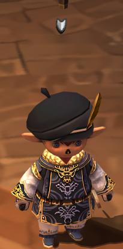
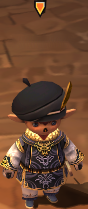

# TargetArrow

[](https://github.com/7h3Cub3/TargetArrow/actions/workflows/check.yml)
[](https://github.com/7h3Cub3/TargetArrow/actions/workflows/release.yml)

**TargetArrow** is an open-source Ashita 4 addon **built and tested for HorizonXI**. It displays a customizable marker above the selected target, including a separate marker for subtarget selection.

**Author:** [7h3Cub3](https://github.com/7h3Cub3) · **Version:** 1.0.0 · **License:** [GPL-3.0-or-later](LICENSE)

## Features

- Gold target cursor and green subtarget cursor by default.
- Independent color presets or custom RGB colors for each cursor.
- Adjustable size, position and model fallback height.
- Optional vertical bobbing and opacity flashing, **both disabled by default**.
- Ashita ImGui configuration window with a **Restore Defaults** button.
- Model-based target positioning even when nameplates are hidden.
- Automatic suppression of the replacement cursor when the native target interface is visible.

## Requirements

- **HorizonXI with Ashita 4**.
- **HideParty**, loaded and actively hiding the native party and target frames.
- XIUI or another replacement UI is optional.

TargetArrow does not alter HideParty. If HideParty is unloaded, the native party or target interface is visible, or the visibility status is unavailable, TargetArrow does not draw its cursor.

## Installation and launcher activation

1. Download **TargetArrow-v1.0.0.zip** from the [Releases page](https://github.com/7h3Cub3/TargetArrow/releases).
2. Extract it into `HorizonXI\Game\addons\`. It creates the folder:

   ```text
   HorizonXI\Game\addons\targetarrow\
   ├── targetarrow.lua
   ├── arrow.png
   ├── subarrow.png
   ├── arrow-neutral.png
   ├── subarrow-neutral.png
   └── LICENSE
   ```

3. In the **HorizonXI launcher**, enable **HideParty** in the addon options if it is listed, and ensure it is configured to hide the native party and target interface.
4. To activate the manually installed TargetArrow addon at game startup, edit `HorizonXI\Game\scripts\default.txt`. In the **Custom user plugins and addons** section, add the following entry in the user-editable area:

   ```text
   /addon load targetarrow
   ```

5. Save the startup script and launch HorizonXI.

Not all custom addons appear as launcher checkboxes. The launcher uses the startup script to load manually installed Ashita addons. See [Installation](docs/INSTALLATION.md).

## Screenshots

| Native target cursor | TargetArrow cursor |
|:---:|:---:|
|  |  |

## Configuration

Enter **`/ta config`** to open or close the settings window. Changes apply immediately and are saved locally (except the session-only enable/disable switch).

The menu offers cursor scale, placement, independent colors, optional bobbing/flashing animation, and **Restore Defaults**. Default values include gold/green cursors, scale `1.0`, vertical offset `4`, model fallback height `1.9` and no animation.

| Command | Description |
| --- | --- |
| `/ta config` | Open or close the ImGui settings window |
| `/ta status` | Display HideParty and rendering diagnostics |
| `/ta on` / `/ta off` / `/ta toggle` | Enable or disable the addon for this session |
| `/ta scale 1.0` | Arrow scale (0.5–2.5) |
| `/ta offset 4` | Vertical offset (-100 to 150 pixels) |
| `/ta height 1.9` | Fallback model height (0–15) |
| `/ta bob on` / `/ta bob off` | Toggle bobbing |
| `/ta flash on` / `/ta flash off` | Toggle flashing |
| `/ta color blue` | Set target cursor color |
| `/ta subcolor purple` | Set subtarget cursor color |

`/targetarrow` is an alias for `/ta`. Color options are Original, Red, Blue, Green, Gold, Purple, Cyan, White and Custom RGB. See the [Configuration guide](docs/CONFIGURATION.md).

## Compatibility and troubleshooting

TargetArrow was developed and tested for **HorizonXI with Ashita 4**. Other clients or Ashita builds have not been verified. Hiding nameplates should not change the marker position, which is derived from model data.

For diagnostics use `/ta status`. `drawing_allowed=true` indicates HideParty's visibility checks passed, while `last_draw`, `anchor`, `draws` and `last_error` provide more detail. See [Troubleshooting](docs/TROUBLESHOOTING.md) and [Technical notes](docs/TECHNICAL.md).

## Downloads and automated releases

Each GitHub Release contains **only the installable `TargetArrow-vX.Y.Z.zip` addon**. GitHub automatically provides **Source code (zip)** and **Source code (tar.gz)** downloads, so no additional source archive is needed.

The [GitHub Actions workflow](.github/workflows/release.yml) builds the addon and publishes the full text of [RELEASE_NOTES.md](RELEASE_NOTES.md) **directly in the release description**. A manual build without a release tag produces a downloadable workflow artifact.

## License

Copyright © 2026 **7h3Cub3**. Licensed under [GPL-3.0-or-later](LICENSE). See [third-party notices](THIRD_PARTY_NOTICES.md).

This project is not affiliated with or endorsed by Square Enix, HorizonXI, Ashita or XIUI.
